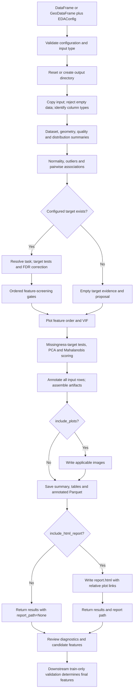

# Detailed EDA pipeline workflow

`EDAPipeline` turns a pandas DataFrame or GeoPandas GeoDataFrame into a statistical
profile, an initial feature proposal, row-level outlier annotations, CSV tables,
plots, and an optional HTML report. It preserves the supplied rows and adds
diagnostic columns to a copy. It does not train a classifier, automatically
remove outliers, or replace source features with imputed/scaled values.

This guide follows [pipeline.py](../../src/eda/pipeline.py). See the
[configuration guide](README.md) and [screening methodology](FEATURE_SELECTION_GUIDE.md)
for related guidance.

## 1. Complete flowchart

[PNG](EDA_PIPELINE_FLOWCHART.png) · [SVG](EDA_PIPELINE_FLOWCHART.svg) ·
[Editable draw.io diagram](EDA_PIPELINE_FLOWCHART.drawio)




The graph groups related diagnostics for readability. Section 5 gives their
actual orchestration order. Model validation is outside `EDAPipeline.run()`.

## 2. Entry points and inputs

| Entry point | Responsibility |
| --- | --- |
| `EDAConfig(...)` | Normalize paths and validate task/options. |
| `EDAPipeline(config).run(df)` | Build evidence, plots, saved tables and optional HTML. |
| `run_eda(df, output_dir, target_column=None, **kwargs)` | Convenience wrapper constructing the configuration and pipeline. |
| `build_eda_artifacts(df, config)` | Build in-memory artifacts without file/plot/report orchestration. |

Input can come from openEO/Planet parcel statistics, enrichment, or an independent
table. EDA does not call acquisition code. Load the file before calling `run()`;
the method accepts a table, not a path.

Supply appropriately typed columns. A date stored as text is categorical until
converted upstream. For parcel analysis, prepare one row per parcel upstream:
EDA reports duplicate attribute rows but does not enforce unique IDs or deduplicate.

Target and ID settings are optional. For numeric class codes, explicitly set
`target_task="classification"`. `auto` treats numeric targets as regression and
other targets as classification. A configured but absent target is recorded as
`target_status="missing"`; it does not by itself stop EDA.

Geometry-specific code looks for a column named `geometry`. Geometry summaries
require compatible accessors and `include_geospatial=True`.

## 3. Validate options and prepare output folders

`EDAConfig.__post_init__()` checks the task, thresholds and feature/display limits.
`run()` checks its argument is a DataFrame, accepting GeoDataFrame subclasses.
It then prepares the output directory:

- `reset_output_dir=True` (default): delete and recreate the configured folder.
- `reset_output_dir=False`: create it if needed and overwrite generated filenames;
  unrelated or no-longer-generated files can remain.
- Create `plots/`, even if plot generation is subsequently disabled.

Use a dedicated EDA run directory and keep source inputs outside it. The empty
input check occurs later, inside artifact construction, **after directory reset**.
This documentation work does not execute that reset or run the analysis.

## 4. Copy and profile the data

`build_eda_artifacts()` copies the input, rejects empty data and identifies column
types. Initial diagnostics describe:

| Diagnostic | Contents |
| --- | --- |
| Dataset summary | Dimensions, options, target status/task, missingness, memory and duplicate attribute rows. |
| Column profile | Dtype/logical type, missingness, uniqueness, constant status and memory. |
| Numeric summaries | Descriptive and robust distribution statistics. |
| Categorical/datetime summaries | Category frequencies and summaries for actual datetime columns. |
| Geospatial summary | CRS, geometry types, missing/empty/invalid geometry, bounds and projected area/length summaries. |

Duplicate detection omits `geometry`. Geometry uniqueness in the column profile
counts geometry **types**, not distinct shapes. EDA does not repair polygons or
automatically reproject data; planar measurements use the supplied projected CRS.

Quality flags accumulate independently:

- `constant`: at most one distinct observed value, including all-null columns.
- `high_missing`: at least 40% missing by default, with some observed values.
- `quasi_constant`: one value accounts for at least 98% of observed rows by
  default, excluding already-constant columns.
- `id_like_or_nearly_unique`: at least 95% unique among observed rows by default.
- `rare_category_heavy`: many distinct categories have very small counts.

Flags do not alter input values. Only constant, quasi-constant and high-missing
flags block the automated proposal's quality gate.

## 5. Calculate statistical evidence

The actual artifact-construction sequence is:

1. Geometry/type discovery and dataset/column summaries.
2. Quality flags and numeric/robust/categorical/datetime summaries.
3. Normality tests and univariate outlier summaries.
4. Pearson/Spearman matrices, strong Pearson pairs, missingness summary and
   categorical pairwise associations.
5. Applicable target tests, association evidence, ordered screening criteria,
   proposal and explanatory message.
6. Plot feature order, then VIF using that numeric order.
7. Missingness-versus-target tests, PCA, Mahalanobis scores, row annotations and
   target summary; then assemble the artifact dictionary.

### Distribution and relationship diagnostics

Normality tests include Shapiro-Wilk, D'Agostino, Jarque-Bera and Anderson-Darling
where sample size permits. Reproducible normality sampling is capped at 5,000
finite values per feature by default. Shared univariate outlier rules use default
thresholds of 1.5 IQR and z-score 3. These summarize unusual values without deletion.

Full numeric correlation matrices can include numeric targets and IDs. Strong
pairs use absolute **Pearson** correlation of at least 0.75 by default. The
proposal's numeric redundancy gate instead uses absolute **Spearman** correlation
at default threshold 0.90.

Categorical pairs use chi-square and conventional Cramer's V, excluding the
configured ID and unsuitable constant/nearly-unique categorical columns.

### Target-dependent branch

| Task | Predictor | Available evidence | Screening measure |
| --- | --- | --- | --- |
| Classification | Numeric | ANOVA, Kruskal-Wallis, eta/epsilon-squared | Kruskal epsilon-squared |
| Classification | Categorical | Chi-square; conventional and corrected Cramer's V | Bias-corrected Cramer's V |
| Regression | Numeric | Pearson, Spearman and Kendall | Absolute Spearman correlation |
| Regression | Categorical | ANOVA/Kruskal comparisons of target across categories | Kruskal epsilon-squared |

Tests use eligible observations; `rows_used` can differ by feature. Group tests
require at least two eligible groups with at least two finite observations each.
Missing labels are not filled. Insufficient data can produce empty diagnostics.

Benjamini-Hochberg adjustment is applied within the respective target-test
families. Screening uses their `qvalue`, with default alpha 0.05.
Missingness-versus-target tests are an additional classification diagnostic;
they do not automatically create model predictors.

Without an available target, target evidence and the feature proposal are empty.
General profiling and row annotation continue. A target alone does not guarantee
a proposal: suitable test evidence is also needed.

## 6. Apply feature-screening gates

The proposal contains features with target-association rows, not every input
column. Target, ID, datetime and columns without eligible tests may be absent.
Use `column_profile.csv` for the complete column inventory.

| Gate, in order | Decision |
| --- | --- |
| Hard exclusions | Exclude target, ID, geometry, known diagnostics, `eda_`-prefixed columns and configured leakage exclusions when encountered. |
| Quality | Exclude constant, quasi-constant or high-missing candidates. |
| Target evidence | Meaningful effect plus FDR support becomes `use`; uncertain or weak-but-significant evidence becomes `review`; limited effect/evidence becomes `exclude`. |
| Redundancy | Compare priority candidates against already-retained same-type features; redundant candidates become `review`. |
| Shortlist cap | Keep at most 50 `use` features by default; overflow becomes `review`. `None` removes the cap. |

Epsilon-squared is moderate from 0.06 and large from 0.14. Absolute Spearman and
corrected Cramer's V are moderate from 0.30 and strong from 0.50. Features are
ranked within their method, then ordered by within-method rank, missingness and
name. Different effect-size scales are not combined into one common score.

Redundancy uses absolute Spearman for numeric pairs and conventional Cramer's V
for categorical pairs, default cutoff 0.90. Mixed-type redundancy and model
interactions are not assessed. The proposal retains reasons, gate flags and
`redundant_with` when applicable.

For example, suppose A and B pass quality checks and have meaningful effects with
`q <= 0.05`. If A ranks first and their absolute Spearman correlation is 0.95,
A stays `use` and B becomes `review`, with `redundant_with="A"`. A tested candidate
C with 45% missing values is excluded at the quality gate. These decisions do
not delete columns from the annotated table.

Known post-outcome columns belong in `feature_selection_exclude_columns`.
Statistical screening cannot infer availability at prediction time. Final
selection requires training-only validation after splitting the data.

## 7. Plot order, VIF, PCA and multivariate outliers

Plots prioritize `use`, then `review`, then `exclude`. Remaining candidates use
quality/missingness ordering. Predictor plot lists omit the target, configured ID
and known prior EDA diagnostics.

| Diagnostic | Subset and internal preparation |
| --- | --- |
| Normality / univariate outliers | Numeric features excluding target, configured ID and known diagnostic columns. |
| VIF | First `max_features_per_plot` numeric candidates in plot order, default 12. |
| PCA | First `max_multivariate_features` numeric columns in input order, default 8. |
| Mahalanobis | First `max_multivariate_features` numeric features after excluding target, ID and known diagnostics. |

VIF, PCA and Mahalanobis internally replace nonfinite values with missing, drop
all-null columns, median-impute remaining gaps, remove constant columns and
standardize. These matrices are diagnostic inputs; the annotated table retains
the original feature values.

**Implementation limits:** the VIF cap limits computation, not just display.
PCA receives the full numeric column list, so its subset can include numeric IDs
or targets. Its subset need not match Mahalanobis or the proposed features.

PCA needs at least two usable columns and three rows. Mahalanobis requires at
least two usable columns and at least `usable_columns + 2` rows. It uses the
covariance pseudo-inverse and a chi-square threshold:

```text
outlier = squared Mahalanobis distance > chi-square quantile(0.975, usable dimensions)
```

This threshold does not force 2.5% of rows to be flagged. All scored rows are
considered; the outlier CSV contains only flagged rows.
`summary["multivariate_features_used"]` records the requested scoring subset;
all-null/constant columns can subsequently be removed in matrix preparation.

## 8. Annotate every input row

The annotated copy retains original rows, attributes and geometry and adds or
replaces three fields:

| Field | Meaning |
| --- | --- |
| `is_outlier_97_5pct` | Nullable Boolean multivariate flag. |
| `mahalanobis_distance` | Distance for a scored row. |
| `mahalanobis_pvalue` | Chi-square tail probability. |

Unavailable scores remain null, not automatically `False`. Alignment uses row
positions, so duplicate source index labels do not misassign scores. The outlier
table retains `row_position` and `source_index` for tracing flagged records.

These full-dataset diagnostics are not recommended model predictors. Investigate
flagged records rather than automatically deleting test rows; fit any model
outlier-handling decisions using training data.

## 9. Generate plots, persist tables and render HTML

After building artifacts, the pipeline optionally prints the feature proposal
message and calls `create_eda_plots()`:

- `include_plots=False` returns an empty `plot_paths` map.
- Otherwise, applicable missingness, quality, distribution, QQ, correlation,
  target, VIF, PCA and geometry images are written under `plots/`.
- Feature charts use `max_features_per_plot` (default 12). Category/target-level
  limits and statistical prerequisites can further restrict a chart.
- CSVs retain computed results, subject to each diagnostic's own calculation
  limits. Missing prerequisites can skip individual images.

Plots are generated **before** table persistence. An unhandled plotting failure
can therefore prevent summary/CSV/Parquet output despite completed in-memory
analysis.

### Output inventory

Paths below are defaults relative to `output_dir`; `artifact_names` can override them.

| Output | Contents |
| --- | --- |
| `eda_summary.json` | Dataset/configuration, schema, plot order and multivariate counts/subset. |
| `eda_annotated_data.parquet` | Full annotated table, preserving GeoParquet metadata for GeoDataFrame input. |
| `tables/overview/` | Column profile and datetime summary. |
| `tables/data_quality/` | Quality flags and missingness summary. |
| `tables/numeric/` | Numeric/robust summaries, normality tests and univariate outliers. |
| `tables/categorical/` | Category summary and pairwise associations. |
| `tables/correlation/` | Strong Pearson pairs, VIF and nonempty Pearson/Spearman matrices. |
| `tables/target/` | Target summary, feature tests/correlations and missingness tests. |
| `tables/feature_selection/` | Association evidence, criteria, `feature_selection_proposal.csv` and proposal text. |
| `tables/multivariate/` | `pca_summary.csv` and flagged `multivariate_outliers.csv` rows. |
| `tables/geospatial/` | Geometry summary, possibly empty when inapplicable. |
| `plots/` | Applicable PNGs; numeric QQ plots are under `qq_plots/`. |
| `report.html` | Optional tabbed report and relative plot references. |

Writes occur in this order: summary JSON, configured CSV tables, proposal text,
annotated Parquet, and nonempty correlation matrices with explicit row labels.
Empty diagnostics can still produce empty table files.

Only afterward does `include_html_report=True` write `report.html`. With HTML
disabled, data artifacts remain available and `report_path=None`. HTML tables are
previews, normally limited to 100 rows; CSVs hold the complete computed tables.
Move/share the report directory with `plots/`, not just the HTML file.

### Return value

| Key | Value |
| --- | --- |
| `summary` | Dataset/configuration/diagnostic summary. |
| `artifacts` | In-memory tables, matrices, ordering, proposal and annotated data. |
| `plot_paths` | Generated image paths. |
| `saved_paths` | Written artifact paths, including HTML when enabled. |
| `report_path` | HTML path or `None`. |
| `annotated_data` | Full annotated DataFrame/GeoDataFrame. |
| `proposed_features` | Names with final action `use`, possibly an empty list. |

## 10. Completion, reruns and troubleshooting

EDA has no stage-resume cache, completion manifest, or transaction covering all
outputs. Every `run()` recomputes analysis. `reset_output_dir=False` preserves the
directory; it does not resume computation or remove obsolete files.

Successful return means all enabled stages finished. Check returned paths,
input/annotated row counts, target status, scoring counts and proposal before
using the results downstream.

| Symptom | Check / interpretation |
| --- | --- |
| Failure before profiling | Config ranges/input type. Empty tables fail after directory preparation. |
| Empty target evidence/proposal | Target existence, task, finite samples and eligible groups. Empty evidence can be legitimate. |
| Statistical test raises | Inspect the traceback and feature/groups. Quality flags are diagnostic; tests precede proposal exclusions and some degenerate data can raise. |
| No PCA/Mahalanobis result | Usable numeric dimensions/rows after subset limits and all-null/constant removal. |
| All outlier flags null | Scoring unavailable; different from scoring rows and finding no outliers. |
| Feature missing from chart | Plot priority, cap, exclusions and diagnostic prerequisites. |
| Feature missing from proposal | Only target-tested features appear; compare column profile and target-test tables. |
| Plots exist but tables missing | Plotting or later persistence failed; writes are sequential without rollback. |
| Tables exist but no HTML | HTML disabled or rendering failed after persistence. |
| Old plots remain | Non-reset runs can retain files absent from the current `plot_paths`. |

EDA does not install acquisition-specific `satellite_*.log` files. Inspect Python
exceptions, notebook output and existing artifacts. Do not rerun notebook cells
just to inspect status: the default reset changes the run directory.

## 11. Usage and Neuro integration

This example is illustrative and was not executed:

```python
from eda import EDAConfig, EDAPipeline

# df is already loaded; keep its source file outside output_dir.
config = EDAConfig(
    output_dir="outputs/neuro/eda_review_01",
    target_column="crop_category",
    target_task="classification",
    id_column="parcel_id",
    feature_selection_max_features=50,
    max_features_per_plot=12,
    reset_output_dir=False,
)
result = EDAPipeline(config).run(df)
proposal = result["artifacts"]["feature_selection_proposal"]
initial_features = result["proposed_features"]
annotated = result["annotated_data"]
```

The current [Neuro notebook](../../notebooks/projects/neuro/3_eda_report.ipynb)
loads `satellite_parcel_time_stats.geoparquet` from its external work directory.
It selects ID, `crop_category`, geometry, selected index median columns and
available extra features before calling `run_eda`. It sets classification,
removes the shortlist cap (`None`), allows 36 plotted features and 20 target
levels, then opens the report in a browser. These are notebook overrides; the
library itself does not launch a browser. Inspect its path/configuration cell
before execution.

The downstream handoff is evidence, candidate features and original/annotated
data. Establish train/test separation and validate feature selection and
preprocessing using training data. Full-dataset exploratory associations are
not held-out evidence of predictive performance.

## 12. Source ownership

| Source | Responsibility |
| --- | --- |
| [pipeline.py](../../src/eda/pipeline.py) | Public API, directory preparation, stage order, persistence and return. |
| [core/config.py](../../src/eda/core/config.py) | Defaults, validation and filenames. |
| [core/profiling_artifacts.py](../../src/eda/core/profiling_artifacts.py) | Evidence/annotation assembly. |
| [core/profiling_summaries.py](../../src/eda/core/profiling_summaries.py) | Dataset, columns, types, target and geometry. |
| [core/profiling_quality.py](../../src/eda/core/profiling_quality.py) | Quality flags. |
| [core/profiling_statistics.py](../../src/eda/core/profiling_statistics.py) | Tests, correlation, FDR and VIF. |
| [core/profiling_feature_selection.py](../../src/eda/core/profiling_feature_selection.py) | Evidence ranking, gates and proposal. |
| [core/profiling_helpers.py](../../src/eda/core/profiling_helpers.py) | Types/tasks, subsets and diagnostic matrices. |
| [core/profiling_multivariate.py](../../src/eda/core/profiling_multivariate.py) | PCA, Mahalanobis integration and annotations. |
| [shared/data_cleaning/outliers.py](../../src/shared/data_cleaning/outliers.py) | Shared outlier algorithms. |
| [visuals/plots_orchestration.py](../../src/eda/visuals/plots_orchestration.py) | Conditional image generation. |
| [reporting/html.py](../../src/eda/reporting/html.py) | HTML, previews and image links. |
| [core/io.py](../../src/eda/core/io.py) | Directory reset and artifact writers. |
