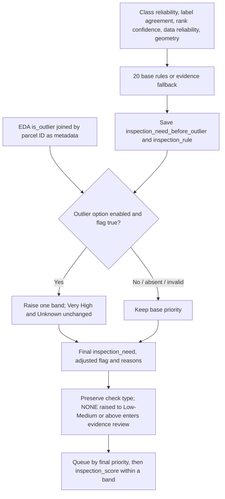

# Inspection Priority Decision Table

Visual reference: [Detailed inspection evidence and priority workflow](INSPECTION_EVIDENCE_AND_PRIORITY_WORKFLOW.png), including
evidence calculations, validation branches, all 20 base rules, the EDA outlier
adjustment, and final queue ordering. Step-by-step version with every setting
and output column: [INSPECTION_WORKFLOW_DIAGRAM.html](INSPECTION_WORKFLOW_DIAGRAM.html).

## Policy and inputs

Step 5 first applies a base rule matrix to five inputs: predicted-class OOF
reliability, declared-versus-predicted label agreement, parcel rank confidence,
data reliability, and geometry risk. The sixth input, EDA `is_outlier`, raises
the base result by one band when `inspection_include_outlier=True` (enabled in
the Neuro workflow; the library default is `False`). It never caps rank confidence with class
reliability. Numeric uncertainty scores do not determine priority or queue order.

The seven ordered priorities are **Very Low, Low, Low–Medium, Medium,
Medium–High, High, Very High**. Medium means inconclusive evidence requiring
verification. Before outlier adjustment, higher bands indicate increasingly
convincing declaration conflicts; lower bands indicate increasingly convincing
agreement. An outlier increase signals additional review priority, not stronger
evidence of a declaration conflict. These are operational
rules, not calibrated probabilities that a declaration is incorrect.

## Base decision table

These rules apply with class reliability enabled and valid inputs. Conditions
within a row use AND. Any means any valid value. The first matching rule wins;
overlapping low-evidence rules always assign Medium. IDs are persisted in
`inspection_rule` so the decision can be traced to this table. The priorities
below are **before** outlier adjustment, recorded in `inspection_need_before_outlier`.

| Rule | Class reliability | Declared vs predicted | Rank confidence | Data reliability | Geometry risk | Base Priority Label |
|---|---|---|---|---|---|---|
| R01 | High | Same | High | > 0.8 | < 0.5 | Very Low |
| R02 | High | Same | High | > 0.8 | >= 0.5 | Low |
| R03 | Medium | Same | High | > 0.8 | < 0.5 | Low |
| R04 | Medium | Same | High | > 0.8 | >= 0.5 | Low–Medium |
| R05 | High | Same | Medium | > 0.8 | < 0.5 | Low–Medium |
| R06 | High | Same | Medium | > 0.8 | >= 0.5 | Medium |
| R07 | Medium | Same | Medium | > 0.8 | Any | Medium |
| R08 | Low | Same | Any | Any | Any | Medium |
| R09 | Any | Same | Low | Any | Any | Medium |
| R10 | Any | Same | Any | <= 0.8 | Any | Medium |
| R11 | High | Different | High | > 0.8 | < 0.5 | Very High |
| R12 | High | Different | High | > 0.8 | >= 0.5 | High |
| R13 | Medium | Different | High | > 0.8 | < 0.5 | High |
| R14 | Medium | Different | High | > 0.8 | >= 0.5 | Medium–High |
| R15 | High | Different | Medium | > 0.8 | < 0.5 | Medium–High |
| R16 | High | Different | Medium | > 0.8 | >= 0.5 | Medium |
| R17 | Medium | Different | Medium | > 0.8 | Any | Medium |
| R18 | Low | Different | Any | Any | Any | Medium |
| R19 | Any | Different | Low | Any | Any | Medium |
| R20 | Any | Different | Any | <= 0.8 | Any | Medium |

The table shows the absolute thresholds. Data reliability must be **strictly
greater than** the applied medium data-reliability threshold (0.8 unless
percentile calibration lowers it, see below). Geometry is favorable when its
saved `geometry_complexity_level` is LOW (see [geometry thresholds](#geometry-thresholds)).
A score exactly at the applied threshold is not high data reliability; a parcel
exactly at a geometry threshold is in the less favorable band. These configuration
settings remain customizable; the comparison operators do not change.

## Geometry thresholds

`geometry_risk` is the parcel's percentile rank of `geom_shape_complexity_score`
among the predicted parcels, so about half of any run ranks at or above 0.5 even
when every parcel is simple. `inspection_geometry_threshold_mode` decides how the
rank is used:

| Mode | Medium complexity when | High complexity when |
|---|---|---|
| `percentile` (default) | `geometry_risk >= 0.50` and complexity `>= 0.60` | `geometry_risk >= 0.75` and complexity `>= 0.90` |
| `absolute` | complexity `>= 0.60` | complexity `>= 0.90` |

The percentile thresholds are `inspection_medium_geometry_risk_threshold` and
`inspection_high_geometry_risk_threshold`; the complexity thresholds are
`inspection_medium_geometry_complexity_threshold` and
`inspection_high_geometry_complexity_threshold`. Medium or high complexity is
"not favorable" in the rule table; the high level only adds the
`HIGH_GEOMETRY_COMPLEXITY` reason. Setting both complexity thresholds to 0 in
percentile mode reproduces the earlier percentile-only policy.

Typical complexity scores, measured with the pipeline's own formula and a 10 m
`all_touched` mask: compact parcels 0.09–0.27, 2:1 strips 0.34–0.52, 3:1 strips
0.51–0.69, 5:1 strips 0.74–0.94 and 8:1 strips about 1.0. Smaller parcels score
higher because of the pixel-agreement penalty. Check the defaults against the
distribution of your own parcels.

## Data-reliability threshold calibration

`data_reliability_score` is the share of observed (not filled) pixel values, so
its level depends on cloud cover and season length. A fixed 0.8 boundary can
classify almost every parcel as weak evidence (rules R10/R20) in a season with
ordinary cloud gaps. `inspection_data_reliability_threshold_mode` controls how
the two data-reliability thresholds are applied:

| Mode | Applied LOW threshold | Applied MEDIUM threshold |
|---|---|---|
| `percentile` (default) | `min(inspection_low_data_reliability_threshold, P_low)` | `min(inspection_medium_data_reliability_threshold, P_medium)` |
| `absolute` | `inspection_low_data_reliability_threshold` (0.60) | `inspection_medium_data_reliability_threshold` (0.80) |

`P_low` and `P_medium` are the `inspection_low_data_reliability_percentile`
(default 0.05) and `inspection_medium_data_reliability_percentile` (default 0.25)
quantiles of the valid scores of all predicted parcels. With the defaults, about
the best 75% of parcels count as high data reliability and about the weakest 5%
receive `LOW_DATA_RELIABILITY`. Percentile mode only relaxes the boundaries: when
coverage is good enough that the percentile exceeds the absolute threshold, the
absolute threshold applies. When no valid score exists, the absolute thresholds
apply.

Percentile mode is relative to the prediction population. It ranks parcels
against each other and does not certify that coverage is adequate in absolute
terms; use `absolute` when a fixed minimum coverage is required.

The applied values are saved on every row as
`inspection_data_reliability_low_threshold` and
`inspection_data_reliability_medium_threshold`, and in `predict_summary.json`
under `inspection_data_reliability_thresholds`. Rules, reason codes, and report
bands all read these saved values. Runs saved before these columns existed are
reported with the absolute thresholds.

## Optional EDA outlier adjustment

This is the final policy stage, applied after both the base matrix and its
fallbacks. For example, `NO_DECLARATION` or `CLASS_RELIABILITY_UNAVAILABLE`
produces Medium before adjustment and Medium–High for an enabled true outlier.
Neither case becomes a declaration conflict.



Set `inspection_include_outlier=True` in `ClassificationPipelineConfig` to apply
`is_outlier` after the matrix. The default is `False`. Supply the Boolean EDA
flag as metadata in the input table, joined by parcel ID; keep it out of
`feature_columns`. Equivalent numeric 0/1 flags are accepted; strings are not.

| Matrix priority | Final priority when enabled and `is_outlier=True` |
|---|---|
| Very Low | Low |
| Low | Low–Medium |
| Low–Medium | Medium |
| Medium | Medium–High |
| Medium–High | High |
| High | Very High |
| Very High | Very High |
| Unknown | Unknown |

False, missing, invalid, or absent flags leave the original matrix priority
unchanged. This option never changes predictions, confidence, or the numeric
inspection score. Outlier escalation alone does not establish a declaration
conflict: the existing check type is preserved, except a previously `NONE`
row raised to Low–Medium or above enters `INSUFFICIENT_EO_EVIDENCE` review. This
includes a matching declaration raised from Low–Medium or Medium.

`inspection_rule` retains the original matrix rule. The output records
`inspection_need_before_outlier`, `inspection_outlier_adjusted`, and reason
`OUTLIER_PRIORITY_INCREASE` when a band actually increases. Very High and Unknown
are not marked adjusted. The queue sorts on final priority using existing stable
ties. Recalculation reapplies the matrix first, so increases never accumulate.
The report and queue include the source flag and adjustment fields.

The report exports `inspection_outlier_priority_transitions.csv` under `data/`
and a matching PNG under `plots/`. Rows show saved base priority, columns show
final priority, and cells count parcels. Diagonal cells are unchanged, including
capped Very High and unscored Unknown. The chart is unavailable for older runs
without saved base priorities; reports never reconstruct decisions from live
configuration. All operational plots use final priority. Score-only plots are
explicitly unaffected by `is_outlier`.

The prediction summary records the enabled switch, whether the column exists,
and the adjusted row count. Existing runs need `is_outlier` already present in
saved predictions for `recalculate_prediction_quality()` to use it; changing
configuration alone cannot add EDA metadata to an older run.

## Disabled and unavailable inputs

- When class reliability is disabled, omit its condition: High rank + high data
  produces Very Low/Very High for Same/Different with favorable geometry and
  Low/High otherwise. Medium rank + high data + favorable geometry produces
  Low–Medium/Medium–High; other valid comparable cases produce Medium. The
  corresponding R01/R02/R05/R06/R09/R10 or R11/R12/R15/R16/R19/R20 identifiers
  are used with `inspection_class_reliability_applied=False`. Class evidence
  is retained unchanged, never relabeled High.
- Enabled reliability that is missing, unrecognized, or invalid due to
  insufficient OOF support produces Medium with
  `inspection_rule=CLASS_RELIABILITY_UNAVAILABLE`. It does not invalidate rank
  confidence. This differs from measured Low reliability in R08/R18.
- A missing declaration with valid prediction evidence produces Medium and
  `inspection_rule=NO_DECLARATION`. No conflict is inferred.
- Missing predictions, invalid/missing rank levels, explicitly invalid rank
  evidence, invalid data reliability (outside [0, 1]), or missing/negative/
  nonfinite geometry complexity produce `UNKNOWN` with
  `inspection_rule=REQUIRED_EVIDENCE_UNAVAILABLE`. Unknown is an unscored status,
  outside the seven priority bands.
- Entirely missing required confidence/data/geometry source columns skip the
  inspection layer with a warning and missing-column metadata.

## Confidence and class evidence

Rank confidence remains HIGH/MEDIUM/LOW from Borda agreement, mean Borda,
rank range and ties. With fewer voting models than the minimum it is graded from
the predicted-class probability instead, and stays valid evidence for these rules. Class reliability never changes
its level, validity, reason, or confidence-only review flag. See the
[confidence methodology](rank_based_ensemble_confidence_methodology.md).

Class reliability is learned only from training OOF predictions of the selected
strategy, using the predicted class's precision and predicted-class support:

| Class reliability | Default rule |
|---|---|
| HIGH | Support >= 100 and precision >= 0.80 |
| MEDIUM | Support >= 100 and precision >= 0.60 but < 0.80 |
| LOW, valid | Support >= 100 and precision < 0.60 |
| LOW, invalid | Support < 100; use the unavailable-evidence fallback |

Step 4 freezes this table and its enabled flag. Step 5 propagates the frozen
flag as `inspection_class_reliability_enabled`, overriding live configuration.
Direct dataframe scoring without this field uses `config.class_reliability_enabled`.

## Geometry and observation evidence

### 2) `data_reliability_score` (from parcel zonal-stat extraction)

This score measures how much of the parcel time-series comes from **original observed pixels** (not filled values).

- `expected_pixel_count = intersected_pixel_count * n_periods * n_variables`
- `observed_count = number of finite pixels in observed_mask`
- `data_reliability_score = observed_count / expected_pixel_count`

Also reported for diagnostics:
- `temporal_filled_ratio = temporal_filled_pixel_count / expected_pixel_count`
- `spatial_filled_ratio = spatial_filled_pixel_count / expected_pixel_count`

### 3) `geom_shape_complexity_score` (from parcel geometry metrics)

This score combines raster/geometry mismatch, boundary irregularity, and elongation using log penalties.

Base geometry metrics:
- `geom_interior_area_ratio = pixel_area / geom_area`
- `geom_compactness = 4πA / P²`
- `geom_perimeter_area_ratio = P / A`
- `geom_shape_index = P / (2*sqrt(πA))`
- `geom_elongation = long_side / short_side` of the minimum rotated rectangle

Penalties:
- `raster_agreement_penalty = |log(geom_interior_area_ratio)|`
- `compactness_penalty = max(0, -0.5*log(geom_compactness))`
- `normalized_perimeter_area_ratio = geom_perimeter_area_ratio / (2*sqrt(π/geom_area))`
- `perimeter_penalty = max(0, log(normalized_perimeter_area_ratio))`
- `shape_index_penalty = max(0, log(geom_shape_index))`
- `elongation_penalty = max(0, log(geom_elongation))`

Then:
- `boundary_penalty = mean(compactness_penalty, perimeter_penalty, shape_index_penalty)`
- `geom_shape_complexity_score = mean(raster_agreement_penalty, boundary_penalty, elongation_penalty)`

Higher values indicate more complex/irregular parcel geometry.

## Outputs and diagnostic score

- `label_prediction_status`: `SAME`, `DIFFERENT`, `NO_DECLARATION` (no declared
  class) or `UNAVAILABLE` (no prediction). Codes are normalized first, so `1.0`
  and `"1"` are the same class.
- `confidence_risk`, `data_risk` (`1 - data_reliability_score`) and `geometry_risk`
  (percentile rank of complexity): the three 0-1 risks behind `inspection_score`.
- `geometry_complexity_level`: LOW, MEDIUM or HIGH, used by the rules and reasons.
- `inspection_need`: machine-readable priority (`VERY_LOW`, `LOW`, `LOW_MEDIUM`,
  `MEDIUM`, `MEDIUM_HIGH`, `HIGH`, `VERY_HIGH`) or unscored `UNKNOWN`.
- `inspection_priority_label`: readable final label after optional outlier adjustment.
- `inspection_rule`: first matching rule ID or explicit fallback identifier.
- `inspection_class_reliability_applied`: whether valid enabled class evidence
  participated in a comparable, valid policy decision.
- `inspection_need_before_outlier`: base matrix or fallback priority.
- `inspection_outlier_adjusted`: True only when the outlier stage increased priority.
- `inspection_check_type`: `NONE` for Very Low/Low, and for Low–Medium/Medium
  when the declaration matches the prediction; `DECLARATION_CONFLICT` for
  Different labels with Medium–High/High/Very High; `INSUFFICIENT_EO_EVIDENCE`
  for remaining base cases (Different labels at Medium, missing declarations,
  unavailable evidence). After outlier adjustment, preserve this type except
  NONE raised to Low–Medium or above becomes `INSUFFICIENT_EO_EVIDENCE`. The last name is retained for compatibility and includes
  model/class uncertainty and missing evidence as well as EO quality issues.
  A matching declaration with inconclusive evidence gives no reason to doubt the
  declaration, so it keeps its Medium priority and reasons but is not queued. Set
  `inspection_check_matching_declarations=True` to restore the earlier behavior,
  which queued these rows as `INSUFFICIENT_EO_EVIDENCE`; with weak evidence for
  many parcels that option queues most of the population.
- `inspection_reasons`: pipe-separated diagnostic reasons, including
  MEDIUM/LOW_CLASS_RELIABILITY, unavailable reliability, and missing declarations.

The former `MEDIUM_UNCERTAIN` category is replaced by Medium with explicit reasons.

For continuity, the numeric score and score-only base category remain diagnostics:

```text
confidence_risk = HIGH: 0.0, MEDIUM: 0.5, LOW: 1.0
inspection_score = 100 * (0.60*confidence_risk
                        + 0.25*(1 - data_reliability_score)
                        + 0.15*geometry_risk)
inspection_need_base = HIGH if score >= 50, MEDIUM if >= 25, otherwise LOW
```

Neither the score nor `inspection_need_base` enters any inspection-priority rule,
so the score thresholds only band the score. The weights do matter for the queue:

The inspection queue includes `inspection_check_type != NONE`, ordered Very
High, High, Medium–High, Medium, Low–Medium, Low, Very Low, then Unknown. Within
a band, parcels with the higher `inspection_score` come first; rows without a
score follow the scored rows of their band, and remaining ties preserve input
order. Exported queue rows include the class evidence, readable label, matched
rule, geometry level, and reasons.

## Settings reference

All settings belong to `ClassificationPipelineConfig`. Settings marked *frozen*
are fixed in Step 4 and need Step 4 again to change; the others are read in Step 5
and can be re-applied with `recalculate_prediction_quality()`.

| Setting | Default | Effect |
|---|---|---|
| `inspection_scoring_enabled` | `True` | Run the inspection layer after prediction. |
| `inspection_data_reliability_column` | `"data_reliability_score"` | Column with the observed share of pixel values (0-1). |
| `inspection_geometry_complexity_column` | `"geom_shape_complexity_score"` | Column with the shape complexity score. |
| `inspection_include_outlier` | `False` | Raise `is_outlier=True` parcels one band. |
| `inspection_check_matching_declarations` | `False` | Also queue Low–Medium and Medium parcels whose declaration matches. |
| `inspection_data_reliability_threshold_mode` | `"percentile"` | `percentile` relaxes the data limits to the run's percentiles; `absolute` applies them as written. |
| `inspection_medium_data_reliability_threshold` | `0.80` | Data reliability must be strictly above the applied value to count as high (rules). |
| `inspection_low_data_reliability_threshold` | `0.60` | Below the applied value the reason is `LOW_DATA_RELIABILITY` (reasons only). |
| `inspection_medium_data_reliability_percentile`, `inspection_low_data_reliability_percentile` | `0.25`, `0.05` | Percentiles used in percentile mode. |
| `inspection_geometry_threshold_mode` | `"percentile"` | `percentile` needs both rank and complexity; `absolute` uses complexity only. |
| `inspection_medium_geometry_risk_threshold`, `inspection_high_geometry_risk_threshold` | `0.50`, `0.75` | Percentile-rank limits for medium and high geometry complexity (percentile mode). |
| `inspection_medium_geometry_complexity_threshold`, `inspection_high_geometry_complexity_threshold` | `0.60`, `0.90` | Complexity-score limits; 0 disables this condition. High affects reasons only. |
| `inspection_model_weight`, `inspection_data_weight`, `inspection_geometry_weight` | `0.60`, `0.25`, `0.15` | Weights of the three risks in `inspection_score`; they order the queue within a band and must sum to 1. |
| `inspection_medium_score_threshold`, `inspection_high_score_threshold` | `25`, `50` | Score limits for `inspection_need_base` (diagnostic only). |
| `class_reliability_enabled` | `True` | *Frozen.* Use class reliability in the rules. |
| `class_reliability_minimum_oof_support` | `100` | *Frozen.* Out-of-fold predictions a class needs for a valid reliability. |
| `class_reliability_high_min_precision`, `class_reliability_medium_min_precision` | `0.80`, `0.60` | *Frozen.* Precision limits for HIGH and MEDIUM class reliability. |
| `rank_confidence_minimum_models` | `3` | *Frozen.* Fewer voting models switch confidence to the probability grade. |

## Practical notes

- About a quarter of parcels fall at or below the medium data boundary in
  percentile mode and are therefore Medium, whatever their confidence.
- A parcel with medium or high geometry complexity can reach at most Low or High,
  never Very Low or Very High.
- To change who is inspected, change the data or geometry thresholds, the outlier
  option or the matching-declarations option. The weights only change the order
  inside a band.
- An outlier increase signals extra review priority, not stronger proof of a
  wrong declaration.

## Updating existing runs

Existing outputs remain unchanged until recalculated. With saved member
probabilities and a supported frozen OOF contract, call
`pipeline.recalculate_prediction_quality()` to apply rank-only confidence and
these rules without retraining. Legacy guard contracts are read as independent
class evidence under the new policy; they no longer cap confidence. Rerun Step 4
first to refresh evaluation confidence artifacts and write the version 3 contract,
or to change the frozen class-reliability flag. Obsolete class x Top-1 contracts
still require Step 4. Recreating HTML reports alone does not recalculate outputs.
