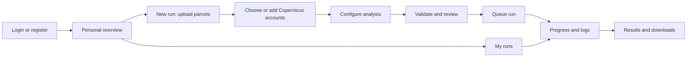
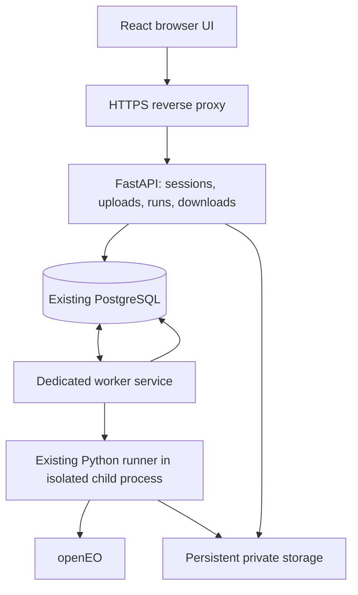

# Parcel Studio: web application design

Status: proposed design, 8 November 2026. Working title and visual direction are
design proposals. Registration with immediate access is the user's confirmed
choice. This document describes future work; the CLI and Docker worker already
exist, but the web application does not yet exist.

Open [the interactive screen preview](design-preview.html) in a browser. It uses
fictional data, performs no authentication or processing, and sends no data.

## Product and visual direction

A small internal team uses one shared server. Each person signs in, uploads parcel
boundaries, stores multiple Copernicus accounts, configures an analysis, and returns
later to download its results. The browser can close while processing continues.

Use a light, spacious workspace with warm off-white backgrounds, forest-green
primary actions, restrained lime highlights, dark readable text, thin borders,
and rounded panels. A persistent navigation rail contains Overview, New run,
My runs, and Copernicus accounts. Account and sign-out controls sit at the bottom.
The parcel footprint is the visual focus, rather than decorative charts.

The proposed name is **Parcel Studio**, with the descriptor **Satellite analysis**.
Use a locally served sans-serif font in production, tabular numbers for counts,
and a monospace face only for logs and JSON. Buttons have visible keyboard focus;
status always has text as well as color. Respect reduced motion. Desktop is the
primary working surface; the rail becomes a compact navigation menu on mobile,
and the wizard's right-hand summary moves below the form.

## Pages and flow

### Login and registration

- Split composition: a calm illustrated landscape on the left, focused form on
  the right. On small screens show the form first.
- Register with username, password, and password confirmation. Successful
  registration creates an active user and signs them in immediately. No approval,
  invitation, or email verification gate. First use offers Add Copernicus account
  and Upload parcels; users can do either first.
- Login errors are generic; show password requirements before submission. A
  password visibility toggle and password-manager support are required.
- Version one has operator-assisted password reset; do not present a nonfunctional
  email reset link. Add email-based recovery only when an email service is defined.
- Logout invalidates the server session. Expired sessions preserve a server-saved
  draft and ask the user to sign in again.
- Keep the deployment on the team's private network initially. Immediate
  registration means anyone who can reach registration can create an account;
  the earlier approved-users-only requirement is superseded by the latest choice.

### Overview and My runs

Overview leads with **New analysis**, a short recent-runs list, and useful counts:
active runs, completed runs, and available Copernicus accounts. Empty states guide
new users rather than showing invented metrics. My runs offers name/status/date
filters and a table with run name, parcel count, period, stage, created date, and
an Open action. Failed and interrupted runs show a clear next action.

### New run: 1. Parcels

- Drag-and-drop or browse for a single GeoPackage, GeoParquet, or GeoJSON. Shapefile
  archives are outside the first release. Start with a configurable 250 MiB upload
  cap and validate actual content, not only the extension.
- For GeoPackages list layers and require selection when ambiguous. Inspect
  columns, let the user choose the parcel ID field and optional partition field,
  and show CRS, parcel count, extent, geometry warnings, and a footprint preview.
- Validate that IDs exist, are non-null and unique after string conversion. Show
  repair/error counts; never silently drop polygons. Keep the uploaded file
  unchanged for reproducibility; use an independently simplified, bounded geometry
  response for the map.
- Reuse a previous owned upload or upload a new one. Each run locks its input
  fingerprint; editing a draft must not mutate a started run's input.

### New run: 2. Copernicus accounts

- Account cards show a label, username, and status: Not tested, Checking,
  Connected, or Needs attention. Stored passwords are never returned to the UI.
- Add multiple accounts with username and password. Encrypt on the server using
  the existing Fernet key before writing `eo_users.password`. Replacing a password
  requires entering a new value; there is no Reveal stored password action.
- Test connection is an explicit action that authenticates with the configured
  openEO backend and creates no processing job. A successful test is timestamped,
  not a promise about future quota or service availability.
- Choose one or more of the user's accounts for this run. Selected account IDs
  and username order are frozen when submitted. Adding another account later must
  not change the account list of a saved run.
- Account deletion/username changes are blocked while referenced by a resumable
  run. Password updates are allowed, matching the existing resume contract.

### New run: 3. Configuration

Lead with Run name, Date range, Sentinel source, Bands and indices, Time interval,
and Statistics. Offer the current JSON as an advanced import/export, not as the
primary input method. Import is allowlisted, validated, and stripped of local
paths and server execution controls. Export contains no credentials or secrets.

| Group | Fields |
| --- | --- |
| Imagery | Start/end dates; Sentinel-2 bands and indices; optional Sentinel-1 bands, indices and orbit direction |
| Aggregation | Temporal period/reducer; spatial statistics such as mean, median and standard deviation |
| Cleaning and filling | Outlier removal, IQR settings, fill enabled, temporal mode/windows, spatial windows, minimum observed fraction and parcel pixels |
| Spatial processing | Automatic projected CRS with manual override; fitted tiles, tile size/buffer; interpolation method, distance and kriging settings |
| Execution | Jobs per account within supported bounds; approved local-worker limit; retain/delete intermediate rasters |

Advanced groups are collapsible with short explanations and units. Derive supported
choices/defaults from the Python validation contract and explicit UI metadata;
do not maintain an independent scientific implementation in JavaScript. Validate
band/index dependencies on the server. Show estimates as estimates, including
tile count and resource demand, never invented cost or completion time.

Paths, owner ID, environment variables, database details and encryption keys are
server-owned and never part of the form. The server generates `output_dir` and
input paths under the authenticated user's storage root.

### New run: 4. Review and submit

Show parcel/layer/ID selection, date range, sensors, statistics, account selection,
normalized settings and preflight warnings. Queue expensive preflight work in the
worker rather than blocking an HTTP request. Start analysis is available only
after successful preflight against this exact draft revision. An edit invalidates
the validation. Submission uses an idempotency key to avoid duplicate runs.

### Run detail

Show separate acquisition, download, local processing and final publication
stages. These can overlap between batches: use counters/timeline rather than
pretending the pipeline is a single sequential percentage. Show elapsed time,
completed/total batches when known, last update and queue position. If reliable
counts are unavailable, show a stage and indeterminate indicator.

Tabs: Overview, Configuration, Logs, Files. Logs support level/source filtering,
tail/pause, last-updated indication and download. Redact credentials before
storage/streaming/export, including third-party error messages. Reconnect after
network loss and distinguish stale status from a failed job.

Initial actions: remove a queued run from the queue; resume an interrupted/failed
run; duplicate settings into a new draft. Active cancellation is deferred until
remote-job cancellation and local interruption are coordinated and tested. Closing
the browser or stopping the local process does not imply remote jobs stopped.

### Results and downloads

Prominent **Download results** for the verified final GeoParquet. Separate items:
cleaning-report CSV, normalized configuration, artifact manifest, and sanitized
logs grouped by pipeline stage/partition. Provide **Download bundle** as an
asynchronously generated ZIP of these allowlisted deliverables. Never zip the
whole run directory: it contains checkpoints and internal metadata.

Completion requires the runner's verified `artifacts.json`, not merely finished
remote openEO jobs. Failed runs can expose logs and configuration, but no misleading
final-results action. Large downloads stream with bounded memory and support
retry. Display sizes, formats and timestamps. Retention is manual in v1; do not
silently expire results. Show disk usage and refuse new work when configured
storage limits are reached.

## Architecture proposal

**Recommended:** React + TypeScript + Vite frontend, FastAPI API, PostgreSQL, and
a separate persistent worker service built from the existing pipeline image.
This offers the desired visual control while reusing the current Python runner.

Alternative: Django with server-rendered pages/HTMX reduces custom authentication
and administration work but changes the proposed frontend architecture. Streamlit
is suitable for an internal prototype, but less suited to this custom multi-page
product experience. These are proposals, not previously approved framework choices.

Use a PostgreSQL-backed durable queue initially, with atomic claims, leases,
heartbeats and crash reconciliation. Start with one processing run across the
server; additional runs remain queued. The worker can execute metadata inspection
and preflight through a separately bounded lane so the UI remains usable. Each
heavy task runs in a child process so native memory is reclaimed on exit.

An expired lease does not immediately start a duplicate process: reconcile the
worker/process identity, acquire the existing filesystem run lock, and inspect
checkpoints before resuming. Fence stale workers with a claim token for DB updates.
Use the persisted remote-job records on resume to avoid blindly creating new jobs.
The active account identities remain reserved while a run's remote jobs may exist;
an interrupted run blocks conflicting identities until reconciliation. A global
singleton worker lease enforces the initial concurrency limit even after accidental
replica scaling. Work done outside the application cannot be quota-coordinated.

Reuse `prepare_run`, `run_parcel_stats`, and `resume_parcel_stats`. The worker must
load the selected owned account IDs and pass their stable ordered credentials to
the dictionary API. The current CLI loads all accounts for a user; using it
unchanged would break per-run account selection and resume after adding accounts.

Add structured lifecycle events where necessary rather than promising progress
from parsing free-form logs alone. Existing `run.json`, remote-job Parquets,
completion markers, and `artifacts.json` supply recovery truth. The database tracks
web-facing queue/state and reconciles with these files.

Docker Compose proposes frontend/proxy, API and worker services, with the existing
PostgreSQL server external or an optional PostgreSQL service for a fresh deployment.
Do not mount the Docker socket into the API. API and worker see identical stable
storage paths; only the worker submits processing jobs. Supply the Fernet key to
the API for encryption and worker for decryption, never to the frontend. Set CPU,
memory, disk and queue limits centrally, not from arbitrary browser JSON.

## Data model and API boundaries

Preserve existing users and accounts with incremental migrations. Inspect the
actual database first: the user's tables were manually created and differ from
the initial SQL file. Align FK types/constraints without dropping records. Use
TEXT for password storage so hashes/tokens cannot be truncated.

| Table | Purpose / proposed additions |
| --- | --- |
| `app_users` | Existing ID, username, password hash, is_active; add timestamps and role if administrative UI is included |
| `eo_users` | Existing owner FK, username, encrypted password; add label, test status/time and timestamps |
| `app_sessions` | Hashed opaque session tokens, user FK, expiry/revocation |
| `parcel_uploads` | Owner, server-generated storage key, original display name, byte size, SHA-256, inspection state and metadata |
| `analysis_runs` | Owner, upload/layer/ID fields, immutable submitted config, revision, state/stage, storage key, image digest, claim/lease/heartbeat and timestamps |
| `run_accounts` | Ordered selected EO-account IDs and frozen username identity; never passwords |
| `run_events` | Structured stage, severity, timestamp, safe message and counters |
| `run_artifacts` | Owner-checked run FK, allowlisted relative storage key, kind, size, checksum and readiness |

Proposed API resources: `/auth/register`, `/auth/login`, `/auth/logout`, `/auth/me`;
`/accounts` and `/accounts/{id}/test`; `/uploads` and inspection metadata;
`/runs` for drafts/listing; `/runs/{id}/validate`, `/submit`, `/resume`, `/events`,
`/artifacts`, `/bundle`; and artifact download endpoints by opaque ID. Add bounded
pagination and polling (initially every five seconds); SSE may follow if needed.

The API derives ownership from its authenticated session, never a browser-supplied
`app_user_id`. Authorize every account, upload, draft, event and download lookup.
Use secure, HttpOnly, SameSite session cookies and CSRF protection on mutations;
restrict login attempts and upload size/rate. Parameterize SQL and validate uploaded
data in the bounded worker process. Resolve artifact paths under the owned run
root; filenames from clients never become arbitrary filesystem paths.

Application passwords use Argon2id hashes. Audit existing `app_users.password`
values before enabling login and migrate confirmed plaintext values or require a
reset; never accept both plaintext and hashes during normal login. EO passwords
already use Fernet, and the existing key must be retained. Configure a dedicated
database role instead of using the current development `postgres` superuser.

## Delivery sequence and verification

1. Review the screen preview and confirm visual direction/framework. Keep a
   frontend demo explicitly separate from a live deployment.
2. Add migrations, password migration/reset tooling, registration, login,
   session isolation and per-user account CRUD. Verify cross-user denials and
   immediate active registration before exposing any live data.
3. Add uploads, layer/field inspection, map preview, config forms and queued
   preflight. Reuse the existing validation contract. Reject stale validation,
   invalid geometry/IDs and traversal attempts.
4. Add durable queue, selected-account snapshots, worker execution, idempotent
   submission, restart recovery and observable progress. Test worker death and
   double submission without sending duplicate remote jobs.
5. Add authorized downloads, safe log viewer, ZIP bundles, resume and duplicate
   run. Test that adding accounts does not alter old runs and incomplete outputs
   cannot be published as final results.
6. Package Compose deployment and run a small end-to-end GeoPackage analysis.
   Test keyboard/mobile layouts, registration/login, user isolation, oversized
   uploads, failed credentials, browser disconnect, server restart and disk limits.

Before release, confirm actual shared-server capacity, network exposure and upload
limits. Starting proposals: private-network HTTPS deployment, 250 MiB per upload,
one processing run at a time, operator-controlled storage cap, and manual retention.
The current local image is proven for CLI operation; live web authentication,
remote cancellation and a durable web queue are new functionality.

## Design review and preview checks

An independent implementation-readiness review found no material unanswered
questions blocking a plan. The preview's JavaScript syntax, navigation targets,
unique HTML IDs and local HTTP serving were checked. The browser-control service
was unavailable, so rendered desktop/mobile layouts and browser interactions have
not been visually verified. The preview is a design artifact, not production code;
its form values and validation states are illustrative and do not persist.

## Technical references

- [FastAPI background tasks](https://fastapi.tiangolo.com/tutorial/background-tasks/)
  explains why heavy processing merits separate worker infrastructure.
- [PostgreSQL SELECT and SKIP LOCKED](https://www.postgresql.org/docs/current/sql-select.html)
  documents row-lock behavior usable by queue consumers. Leasing/recovery remain
  application responsibilities.
- [OWASP password storage](https://cheatsheetseries.owasp.org/cheatsheets/Password_Storage_Cheat_Sheet.html)
  supports Argon2id for application password hashing.
- Existing [CLI contract](../data_preparation/openeo/CLI.md),
  [Docker guide](../data_preparation/openeo/DOCKER.md), and
  [scheduling guide](../data_preparation/openeo/SCHEDULING.md).
